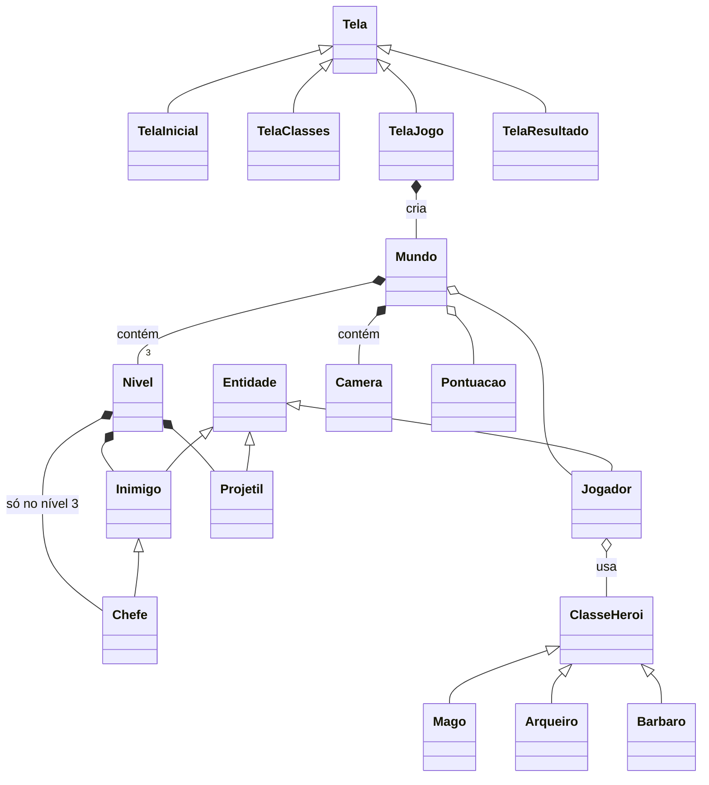
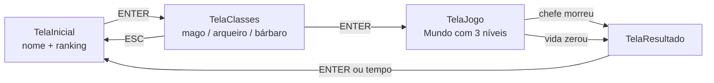
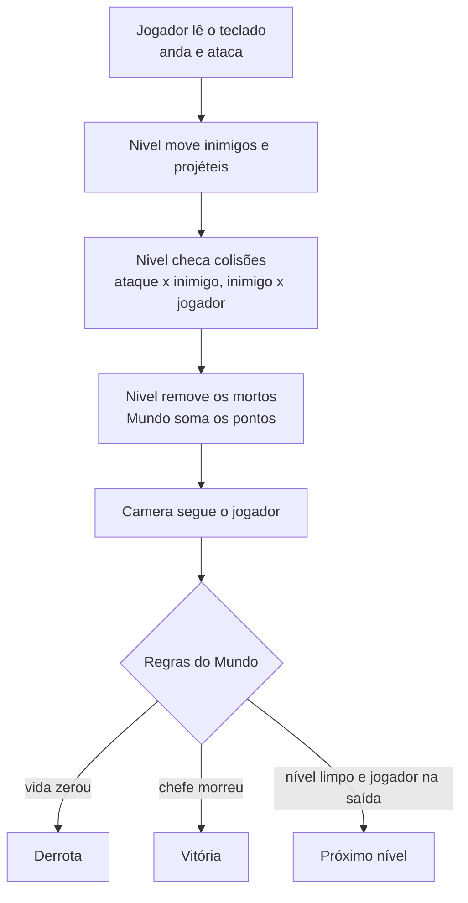

# Arquitetura

Este documento explica como o Legend of Insper está organizado: as camadas, o que cada arquivo faz, como as telas se encadeiam e como um quadro do jogo é processado. Os arquivos `.py` já existem, mas só com a descrição do que vão conter; o código ainda vai ser escrito.

O jogo: o jogador digita o nome (com o ranking ao lado), escolhe uma classe (Mago, Arqueiro ou Bárbaro) e entra no Mundo, que tem 3 níveis. Cada nível é um mapa maior que a tela, e a câmera segue o jogador, como nos Pokémon antigos. No último nível tem um chefe. Ganhando ou perdendo, a pontuação vai para o ranking. O tema (torre, Insper ou dungeon) ainda não foi decidido, então ele fica separado em um arquivo só de dados.

## Camadas

O projeto é dividido em cinco pastas, e as dependências sempre apontam para baixo:

| Camada | Pasta | Responsabilidade | Depende de |
|---|---|---|---|
| Aplicação | `aplicacao/` | Loop principal: janela, FPS, troca de telas e dados da partida | Telas |
| Telas | `telas/` | As 4 telas do jogo e o fluxo entre elas | UI, Jogo, Personagens |
| UI | `ui/` | Peças de tela reaproveitáveis: caixa de texto, ranking, cartão de classe, HUD | Só pygame |
| Jogo | `jogo/` | Mundo, níveis, câmera, temas, pontuação e ranking | Personagens |
| Personagens | `personagens/` | Jogador, inimigos, chefe, projéteis e as classes jogáveis | Nada (só pygame) |

`settings.py` fica fora das camadas e guarda as cores RGB do jogo. Outras configurações (resolução, FPS, valores de pontos) podem ir para lá conforme forem precisando.

Os personagens não conhecem as telas, e as regras do jogo não desenham menus. Assim cada pasta pode ser feita por uma pessoa diferente sem uma atrapalhar a outra.

## Estrutura do repositório

```
The_Legend_of_Insper/
├── requirements.txt              pygame
├── docs/ARQUITETURA.md           este documento
└── src/
    ├── main.py                   Ponto de entrada: cria a Aplicacao e executa
    ├── settings.py               Cores RGB
    ├── assets/                   Sprites, tilesets, sons e fontes
    ├── data/                     ranking.json (criado na primeira partida)
    ├── aplicacao/
    │   └── aplicacao.py          Loop principal e troca de telas
    ├── telas/
    │   ├── tela.py               Classe base de todas as telas
    │   ├── tela_inicial.py       Nome do jogador + ranking
    │   ├── tela_classes.py       Escolha de Mago, Arqueiro ou Bárbaro
    │   ├── tela_jogo.py          Cria o Mundo e mostra o jogo
    │   └── tela_resultado.py     Vitória/derrota, pontos, salva no ranking
    ├── ui/
    │   ├── caixa_texto.py        Campo para digitar o nome
    │   ├── painel_ranking.py     Lista do ranking
    │   ├── cartao_classe.py      Cartão de cada classe na escolha
    │   └── hud.py                Vida, pontos, nível e vida do chefe
    ├── jogo/
    │   ├── mundo.py              Contém os 3 níveis e controla a partida
    │   ├── nivel.py              Um mapa grande: paredes, inimigos, saída
    │   ├── camera.py             Mostra só o pedaço do mapa perto do jogador
    │   ├── temas.py              Torre / Insper / dungeon e seus 3 níveis
    │   ├── pontuacao.py          Soma de pontos e bônus finais
    │   └── ranking.py            Lê e salva o ranking em JSON
    └── personagens/
        ├── entidade.py           Base: posição, sprite, vida
        ├── jogador.py            Personagem controlado pelo teclado
        ├── inimigo.py            Inimigos comuns
        ├── chefe.py              Boss do último nível
        ├── projetil.py           Flecha, bola de fogo, tiro do chefe
        └── classes/
            ├── classe_heroi.py   Base das classes jogáveis
            ├── mago.py
            ├── arqueiro.py
            └── barbaro.py
```

## Principais classes

| Classe | Arquivo | Papel |
|---|---|---|
| `Aplicacao` | `aplicacao/aplicacao.py` | Abre a janela, roda o loop, guarda a tela ativa e os dados da partida (nome, classe, pontuação). |
| `Tela` | `telas/tela.py` | Molde das telas: `tratar_evento`, `atualizar` e `desenhar`. |
| `TelaInicial` | `telas/tela_inicial.py` | Campo do nome e ranking ao lado. ENTER vai para a escolha de classe. |
| `TelaClasses` | `telas/tela_classes.py` | Mostra as 3 classes; ENTER começa o jogo, ESC volta. |
| `TelaJogo` | `telas/tela_jogo.py` | Cria o Jogador e o Mundo, repassa o teclado e desenha. Quando o Mundo termina, vai para o resultado. |
| `TelaResultado` | `telas/tela_resultado.py` | Mostra o resultado, salva no ranking e volta ao início. |
| `CaixaTexto`, `PainelRanking`, `CartaoClasse`, `Hud` | `ui/` | Desenham partes da tela; não têm regra de jogo. |
| `Mundo` | `jogo/mundo.py` | Contém os 3 Niveis e a Camera. Controla a partida: troca de nível, soma pontos, decide vitória e derrota. |
| `Nivel` | `jogo/nivel.py` | Um mapa maior que a tela, com paredes, inimigos, projéteis e a saída. Move tudo e checa colisões. |
| `Camera` | `jogo/camera.py` | Segue o jogador e converte posições do mapa em posições na tela. |
| `temas` | `jogo/temas.py` | Só dados: os temas, seus 3 níveis (nome, tamanho, cores, inimigos) e o chefe. |
| `Pontuacao` | `jogo/pontuacao.py` | Soma pontos durante a partida e aplica os bônus no fim. |
| `Ranking` | `jogo/ranking.py` | Lê, adiciona e salva partidas em `data/ranking.json`. |
| `Entidade` | `personagens/entidade.py` | Base de tudo que está no nível: posição no mapa, sprite, vida, receber dano. |
| `Jogador` | `personagens/jogador.py` | Anda, ataca e usa o especial pedindo para a classe escolhida. |
| `Inimigo` | `personagens/inimigo.py` | Persegue o jogador quando ele chega perto, dá dano ao encostar, vale pontos. |
| `Chefe` | `personagens/chefe.py` | Inimigo com muita vida e ataque próprio. Matar ele vence o jogo. |
| `Projetil` | `personagens/projetil.py` | Voa em linha reta, some na parede ou ao acertar. |
| `ClasseHeroi` | `personagens/classes/classe_heroi.py` | Molde das classes: atributos, `atacar` e `especial`. |
| `Mago`, `Arqueiro`, `Barbaro` | `personagens/classes/` | Cada uma com seus atributos e seu jeito de atacar. |

### Herança e composição



Dois tipos de relação aparecem no diagrama:

- **Herança** (seta com triângulo): `Chefe` **é um** `Inimigo`, `Mago` **é uma** `ClasseHeroi`. A filha reaproveita tudo da mãe e muda só o que precisa.
- **Composição** (seta com losango): o `Mundo` **contém** 3 `Niveis` e uma `Camera`; cada `Nivel` **contém** seus inimigos. O `Jogador` **tem** uma `ClasseHeroi` em vez de **ser** um mago ou arqueiro: quando ele aperta ESPAÇO, chama `classe.atacar(jogador)` e cada classe decide o que acontece. Por isso, criar uma classe nova não exige mexer no `Jogador`.

## Mundo, níveis e câmera

O `Mundo` é criado pela `TelaJogo` a partir do tema escolhido. Ele monta os 3 `Niveis` e joga um de cada vez:

- o `Jogador` passa de um nível para o outro com a vida que sobrou;
- nos níveis 1 e 2, a saída abre quando todos os inimigos morrem, e encostar nela leva ao próximo nível;
- no nível 3 está o `Chefe`, e matar ele vence a partida;
- se a vida do jogador zerar em qualquer nível, a partida acaba em derrota.

Cada `Nivel` é um mapa de tiles (quadradinhos de 16×16 pixels) maior que a tela, por exemplo 3 telas de largura por 2 de altura. A tela do jogo mostra só um recorte desse mapa, e quem decide qual recorte é a `Camera`:

- a cada quadro, `camera.seguir(jogador)` centraliza o recorte no jogador;
- perto das bordas do mapa, a câmera para e quem anda na tela é o jogador;
- tudo que é desenhado dentro do nível passa por `camera.para_tela(...)`, que converte a posição no mapa para a posição na tela;
- o `Hud` não usa a câmera, porque fica sempre fixo na tela.

## Fluxo de telas



Os dados da partida ficam na `Aplicacao`: a `TelaInicial` grava o nome, a `TelaClasses` grava a classe, o `Mundo` soma os pontos na `Pontuacao` e a `TelaResultado` lê tudo para salvar no ranking.

## Um quadro do jogo

`Aplicacao.executar` roda um loop com três passos por quadro, como o `Aplicacao::executar` do simulacao_lobo_coelho:

1. Trata os eventos do pygame (fechar a janela, teclas) e repassa para a tela ativa.
2. Chama `tela.atualizar(dt)`, onde `dt` é o tempo desde o quadro anterior.
3. Chama `tela.desenhar(...)` numa superfície pequena (resolução de GBA, 240×160) e aumenta para a janela.

Durante a partida, a `TelaJogo` chama `mundo.atualizar(dt)`, que faz, nesta ordem:



Depois, `mundo.desenhar` desenha só o pedaço do nível que a câmera mostra, e a `TelaJogo` desenha o `Hud` por cima.

## Pontuação

- cada inimigo derrotado vale os seus pontos (ideia: 50 a 100);
- nível concluído: 500; chefe derrotado: 2000;
- só se vencer: bônus por terminar rápido e por vida que sobrou.

Perdendo, o que foi somado até ali vai para o ranking do mesmo jeito.

## Como adicionar uma classe jogável

1. Crie `personagens/classes/<nome>.py` com uma classe que herda de `ClasseHeroi`.
2. Defina nome, descrição, atributos, `atacar` e `especial`.
3. Coloque a classe na lista que a `TelaClasses` mostra.

## Como adicionar um inimigo

1. Em `personagens/inimigo.py`, crie o novo tipo com vida, velocidade, sprite e pontos.
2. Em `jogo/temas.py`, coloque ele nos níveis em que deve aparecer.

## Como trocar ou criar um tema

1. Em `jogo/temas.py`, crie ou edite o tema com seus 3 níveis (nome, tamanho do mapa, cores e inimigos).
2. Escolha qual tema o `Mundo` usa.

## Ordem sugerida para implementar

1. `main.py`, `aplicacao.py` e `tela.py`: abrir a janela e trocar de tela.
2. `tela_inicial.py` com `caixa_texto.py`: digitar o nome.
3. `tela_classes.py` com `cartao_classe.py`: escolher a classe.
4. `entidade.py`, `jogador.py`, `nivel.py` e `camera.py`: andar por um mapa grande com a câmera seguindo.
5. `classe_heroi.py`, as 3 classes e `projetil.py`: atacar.
6. `inimigo.py` e `chefe.py`: inimigos e colisões.
7. `temas.py` e `mundo.py`: os 3 níveis em sequência.
8. `pontuacao.py`, `ranking.py`, `painel_ranking.py`, `hud.py` e `tela_resultado.py`: pontos e ranking.

## Divisão sugerida do grupo

| Pessoa | Pastas |
|---|---|
| 1 | `aplicacao/`, `telas/` |
| 2 | `ui/` |
| 3 | `personagens/` |
| 4 | `jogo/` |

## Observações

- As pastas não têm `__init__.py`. No Python 3 isso não é obrigatório para importar (`from personagens.jogador import Jogador` funciona rodando `python src/main.py`).
- Os mapas dos níveis podem começar como uma grade escrita à mão em `temas.py` e depois passar a ser desenhados num editor como o [Tiled](https://www.mapeditor.org/).
